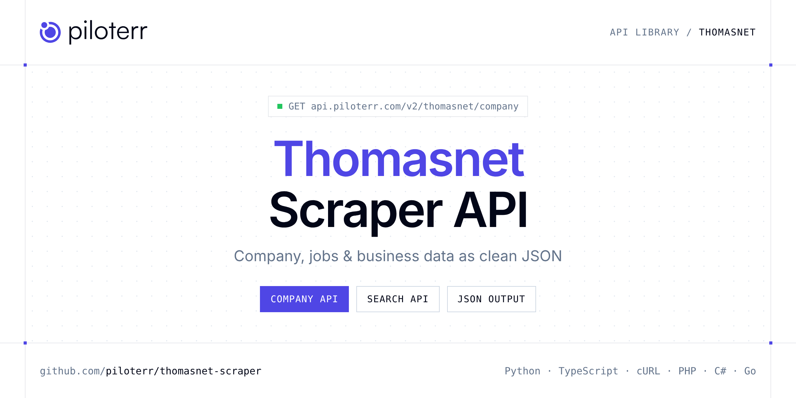

<p align="center">
  <a href="https://www.piloterr.com"></a>
</p>

# Thomasnet Scraper API

[](https://discord.gg/CFj3ph8aHU) [](https://app.piloterr.com) [](https://app.piloterr.com/openapi) [](LICENSE)

The **Piloterr Thomasnet Scraper API** lets you extract public data from Thomasnet as **clean, structured JSON** — no proxies, headless browsers or HTML parsing to maintain. Endpoints available in production:

- **Thomasnet Company API** — Get a full Thomasnet supplier profile from a company URL, including contact details, product categories, and business information.
- **Thomasnet Search API** — Search Thomasnet suppliers from a search or category URL and get company listings, filters, name suggestions, and pagination.

Use it for lead generation, CRM enrichment, market mapping, investment research or job market analytics.

| Endpoint | Path | Credits | What you get |
|---|---|---|---|
| [Thomasnet Company API](#thomasnet-company-api) | `/v2/thomasnet/company` | 3 | Get a full Thomasnet supplier profile from a company URL, including contact details, product categories, and business information. |
| [Thomasnet Search API](#thomasnet-search-api) | `/v2/thomasnet/search` | 3 | Search Thomasnet suppliers from a search or category URL and get company listings, filters, name suggestions, and pagination. |

## Table of contents

- [How it works](#how-it-works)
- [Thomasnet Company API](#thomasnet-company-api)
- [Thomasnet Search API](#thomasnet-search-api)
- [Code examples in other languages](#code-examples-in-other-languages)
- [Practical use cases](#practical-use-cases)
- [Why Piloterr?](#why-piloterr)
- [FAQ](#faq)
- [Related scrapers](#related-scrapers)
- [Support](#support)

## How it works

1. **Create a free Piloterr account** and copy your API key from the [dashboard](https://app.piloterr.com).
2. **Send a `GET` (or `POST`) request** to `https://api.piloterr.com/v2/...` with the header `x-api-key: YOUR_API_KEY`.
3. **Receive structured JSON** — Piloterr handles rendering, proxies, retries and parsing.

```bash
export PILOTERR_API_KEY="your-api-key"
pip install requests        # Python
# TypeScript: Node.js 18+ (native fetch), run with `npx tsx file.ts`
```

> Every endpoint accepts both `GET` (query string) and `POST` (JSON body with the same fields).

## Thomasnet Company API

Get a full Thomasnet supplier profile from a company URL, including contact details, product categories, and business information.

`GET | POST https://api.piloterr.com/v2/thomasnet/company` · **3 credits per request** · [Full reference](https://app.piloterr.com/openapi)

### Request parameters

| Parameter | Type | Required | Description |
|---|---|---|---|
| `query` | string | ✅ | Full Thomasnet company profile URL from your browser. |

### Python example

```python
import json
import os
import requests

response = requests.get(
    "https://api.piloterr.com/v2/thomasnet/company",
    headers={"x-api-key": os.environ["PILOTERR_API_KEY"]},
    params={
        "query": "https://www.thomasnet.com/company/zepole-supply-co-20088400/profile",
    },
    timeout=60,
)
response.raise_for_status()
data = response.json()

print(json.dumps(data, indent=2, ensure_ascii=False)[:2000])
```

### TypeScript example

```typescript
type ThomasnetCompany = {
  company?: {
    ads?: unknown;
    url?: string;
    name?: string;
    news?: unknown;
    tier?: string;
    type?: string;
    brands?: unknown;
    social?: unknown;
    videos?: unknown;
    address?: {
      zip?: string;
      city?: string;
      zip4?: unknown;
      state?: string;
      county?: unknown;
      country?: string;
      address1?: string;
      address2?: unknown;
      address3?: unknown;
      latitude?: number;
      longitude?: number;
      state_name?: string;
    };
    heading?: {
      url?: unknown;
      name?: string;
      family_id?: string;
      heading_id?: string;
      description?: string;
      family_name?: string;
      natural_name?: string;
    };
    website?: string;
    families?: {
      id?: string;
      name?: string;
    }[];
    headings?: {
      url?: unknown;
      name?: string;
      heading_id?: string;
      description?: string;
      family_name?: string;
    }[];
    logo_url?: unknown;
    premiums?: unknown;
    products?: unknown;
    personnel?: unknown;
    tgrams_id?: string;
    company_ad?: unknown;
    is_claimed?: boolean;
    logo_title?: string;
    description?: string;
    whitepapers?: unknown;
    annual_sales?: string;
    [key: string]: unknown;
  };
  products?: {
    products?: unknown[];
    categories?: unknown[];
    capabilities?: unknown[];
    configurators?: unknown[];
  };
  search_term?: string;
  business_details?: {
    first_column_sections?: {
      items?: Record<string, unknown>[];
      label?: string;
    }[];
    second_column_sections?: {
      items?: Record<string, unknown>[];
      label?: string;
    }[];
  };
  navigation_headings?: {
    id?: string;
    url_slug?: string;
    natural_name?: string;
  }[];
};

const params = new URLSearchParams({
  "query": "https://www.thomasnet.com/company/zepole-supply-co-20088400/profile",
});

const response = await fetch(`https://api.piloterr.com/v2/thomasnet/company?${params}`, {
  headers: { "x-api-key": process.env.PILOTERR_API_KEY! },
});
if (!response.ok) throw new Error(`Piloterr error ${response.status}: ${await response.text()}`);

const data = (await response.json()) as ThomasnetCompany;

console.log(JSON.stringify(data, null, 2).slice(0, 2000));
```

<details>
<summary><b>POST variant</b></summary>

```http
POST https://api.piloterr.com/v2/thomasnet/company
x-api-key: YOUR_API_KEY
Content-Type: application/json

{"query": "https://www.thomasnet.com/company/zepole-supply-co-20088400/profile"}
```
</details>

### Output example

Example response from the API reference, abridged — real values depend on the page you scrape.

```json
{
  "company": {
    "ads": null,
    "url": "https://www.thomasnet.com/company/zepole-supply-co-20088400/profile",
    "name": "Zepole Supply Co.",
    "news": null,
    "tier": "NONE",
    "type": "D",
    "brands": null,
    "social": null,
    "videos": null,
    "address": {
      "zip": "60440",
      "city": "Bolingbrook",
      "zip4": null,
      "state": "IL",
      "county": null,
      "country": "USA",
      "address1": "506 E. North Frontage Rd",
      "address2": null,
      "address3": null,
      "latitude": 41.69832555,
      "longitude": -88.0778819,
      "state_name": "Illinois"
    },
    "heading": {
      "url": null,
      "name": "Forks: Table",
      "family_id": "157835",
      "heading_id": "31172406",
      "description": "Flatware distributor providing a full line of products for the restaurant industry. Stainless steel forks are offered in four different s…",
      "family_name": "Forks",
      "natural_name": "Table Forks"
    },
    "website": "https://zepole.com/",
    "families": [
      {
        "id": "157336",
        "name": "Cabinets"
      },
      {
        "id": "160228",
        "name": "Dinnerware"
      }
    ],
    "headings": [
      {
        "url": null,
        "name": "Bakery Shelving",
        "heading_id": "96112289",
        "description": "A distributor of shelves and shelving units for the baking industry. These units are constructed of chrome plated wire shelves and are av…",
        "family_name": "Shelves and Shelving"
      },
      {
        "url": null,
        "name": "Cabinets",
        "heading_id": "9387309",
        "description": "Distributor of restaurant equipment & supplies including bakery, bar, cooking, counter, concession, dining room, display, serving, food p…",
        "family_name": "Cabinets"
      }
    ],
    "logo_url": null,
    "premiums": null,
    "products": null,
    "personnel": null,
    "tgrams_id": "20088400",
    "company_ad": null,
    "is_claimed": false,
    "logo_title": "Zepole Supply Co. Company Logo",
    "description": "A distributor of shelves and shelving units for the baking industry. These units are constructed of chrome plated wire shelves and are av…",
    "whitepapers": null,
    "annual_sales": "Under $1 Mil"
  },
  "products": {
    "products": [],
    "categories": [],
    "capabilities": [],
    "configurators": []
  },
  "search_term": "Table Forks",
  "business_details": {
    "first_column_sections": [
      {
        "items": [
          {},
          {}
        ],
        "label": "Website"
      },
      {
        "items": [
          {}
        ],
        "label": "Primary Company Type"
      }
    ],
    "second_column_sections": [
      {
        "items": [
          {}
        ],
        "label": "Annual Sales:"
      },
      {
        "items": [
          {}
        ],
        "label": "No of Employees:"
      }
    ]
  },
  "navigation_headings": [
    {
      "id": "31161201",
      "url_slug": "forks",
      "natural_name": "Forks"
    },
    {
      "id": "31172406",
      "url_slug": "table-forks",
      "natural_name": "Table Forks"
    }
  ]
}
```

### Response fields

| Field | Type | Description |
|---|---|---|
| `company` | object |  |
| `company.ads` | object |  |
| `company.url` | string |  |
| `company.name` | string |  |
| `company.news` | object |  |
| `company.tier` | string |  |
| `company.type` | string |  |
| `company.brands` | object |  |
| `company.social` | object |  |
| `company.videos` | object |  |
| `company.address` | object |  |
| `company.heading` | object |  |
| `company.website` | string |  |
| `company.families[]` | object[] |  |
| `company.headings[]` | object[] |  |
| `company.logo_url` | object |  |
| `company.premiums` | object |  |
| `company.products` | object |  |
| `company.personnel` | object |  |
| `company.tgrams_id` | string |  |
| `company.company_ad` | object |  |
| `company.is_claimed` | boolean |  |
| `company.logo_title` | string |  |
| `company.description` | string |  |
| `company.whitepapers` | object |  |

## Thomasnet Search API

Search Thomasnet suppliers from a search or category URL and get company listings, filters, name suggestions, and pagination.

`GET | POST https://api.piloterr.com/v2/thomasnet/search` · **3 credits per request** · [Full reference](https://app.piloterr.com/openapi)

### Request parameters

| Parameter | Type | Required | Description |
|---|---|---|---|
| `query` | string | ✅ | Full Thomasnet search URL from your browser. |

### Python example

```python
import json
import os
import requests

response = requests.get(
    "https://api.piloterr.com/v2/thomasnet/search",
    headers={"x-api-key": os.environ["PILOTERR_API_KEY"]},
    params={
        "query": "https://www.thomasnet.com/suppliers/search?searchterm=Table+Forks",
    },
    timeout=60,
)
response.raise_for_status()
data = response.json()

print(json.dumps(data, indent=2, ensure_ascii=False)[:2000])
```

### TypeScript example

```typescript
type ThomasnetSearch = {
  filters?: {
    id?: string;
    count?: number;
    label?: string;
    section?: string;
  }[];
  results?: {
    url?: string;
    name?: string;
    rank?: string;
    tier?: string;
    type?: string;
    videos?: unknown;
    address?: {
      zip?: string;
      city?: string;
      zip4?: unknown;
      state?: string;
      county?: unknown;
      country?: string;
      address1?: string;
      address2?: unknown;
      address3?: unknown;
      latitude?: number;
      longitude?: number;
      state_name?: string;
    };
    heading?: unknown;
    website?: string;
    distance?: unknown;
    headings?: {
      heading_id?: string;
      natural_name?: string;
    }[];
    logo_url?: unknown;
    pdm_text?: string;
    products?: unknown;
    tgrams_id?: string;
    is_claimed?: boolean;
    logo_title?: string;
    description?: string;
    annual_sales?: string;
    capabilities?: {
      type?: string;
      names?: string[];
    }[];
    catalog_type?: unknown;
    year_founded?: string;
    is_advertiser?: boolean;
    primary_phone?: string;
    heading_brands?: {
      name?: string;
    }[];
    [key: string]: unknown;
  }[];
  pagination?: {
    current?: number;
    per_page?: number;
    total_pages?: number;
    has_next_page?: boolean;
    total_results?: number;
  };
  search_term?: string;
  company_name_matches?: {
    url?: string;
    name?: string;
    tier?: string;
    type?: string;
    social?: unknown;
    address?: {
      zip?: string;
      city?: string;
      zip4?: unknown;
      state?: string;
      county?: unknown;
      country?: string;
      address1?: string;
      address2?: unknown;
      address3?: unknown;
      latitude?: number;
      longitude?: number;
      state_name?: string;
    };
    heading?: unknown;
    website?: unknown;
    headings?: unknown;
    logo_url?: unknown;
    premiums?: unknown;
    personnel?: unknown;
    tgrams_id?: string;
    is_claimed?: boolean;
    logo_title?: string;
    description?: string;
    annual_sales?: string;
    catalog_type?: unknown;
    year_founded?: string;
    is_advertiser?: boolean;
    primary_phone?: string;
    location_types?: {
      id?: number;
      name?: string;
    }[];
    is_top_responder?: unknown;
    number_employees?: string;
    other_activities?: unknown;
    [key: string]: unknown;
  }[];
};

const params = new URLSearchParams({
  "query": "https://www.thomasnet.com/suppliers/search?searchterm=Table+Forks",
});

const response = await fetch(`https://api.piloterr.com/v2/thomasnet/search?${params}`, {
  headers: { "x-api-key": process.env.PILOTERR_API_KEY! },
});
if (!response.ok) throw new Error(`Piloterr error ${response.status}: ${await response.text()}`);

const data = (await response.json()) as ThomasnetSearch;

console.log(JSON.stringify(data, null, 2).slice(0, 2000));
```

<details>
<summary><b>POST variant</b></summary>

```http
POST https://api.piloterr.com/v2/thomasnet/search
x-api-key: YOUR_API_KEY
Content-Type: application/json

{"query": "https://www.thomasnet.com/suppliers/search?searchterm=Table+Forks"}
```
</details>

### Output example

Example response from the API reference, abridged — real values depend on the page you scrape.

```json
{
  "filters": [
    {
      "id": "Any Glass",
      "count": 1,
      "label": "Any Glass",
      "section": "Materials"
    },
    {
      "id": "Any Plastic",
      "count": 1,
      "label": "Any Plastic",
      "section": "Materials"
    }
  ],
  "results": [
    {
      "url": "https://www.thomasnet.com/company/terriss-consolidated-industries-inc-574321/profile",
      "name": "Terriss Consolidated Industries, Inc.",
      "rank": "53.83929",
      "tier": "NONE",
      "type": "M",
      "videos": null,
      "address": {
        "zip": "07712",
        "city": "Asbury Park",
        "zip4": null,
        "state": "NJ",
        "county": null,
        "country": "USA",
        "address1": "807 Summerfield Ave.",
        "address2": null,
        "address3": null,
        "latitude": 40.24707252,
        "longitude": -74.0496745,
        "state_name": "New Jersey"
      },
      "heading": null,
      "website": "https://www.terriss.com/",
      "distance": null,
      "headings": [
        {}
      ],
      "logo_url": null,
      "pdm_text": "Manufacturer & stocking distributor of Pyrex® glass, screw top & round bottom culture tubes. Available in 13 mm x 100 mm to 25 mm x 200 m…",
      "products": null,
      "tgrams_id": "574321",
      "is_claimed": false,
      "logo_title": "Terriss Consolidated Industries, Inc. Company Logo",
      "description": "Manufacturer & stocking distributor of biodegradable products, scientific instruments & laboratory supplies & stainless steel products. P…",
      "annual_sales": "$1 - 4.9 Mil",
      "capabilities": [
        {}
      ],
      "catalog_type": null,
      "year_founded": "1895",
      "is_advertiser": false,
      "primary_phone": "(732) 988-0909",
      "heading_brands": [
        {}
      ]
    },
    {
      "url": "https://www.thomasnet.com/company/zepole-supply-co-20088400/profile",
      "name": "Zepole Supply Co.",
      "rank": "51.568188",
      "tier": "NONE",
      "type": "D",
      "videos": null,
      "address": {
        "zip": "60440",
        "city": "Bolingbrook",
        "zip4": null,
        "state": "IL",
        "county": null,
        "country": "USA",
        "address1": "506 E. North Frontage Rd",
        "address2": null,
        "address3": null,
        "latitude": 41.69832555,
        "longitude": -88.0778819,
        "state_name": "Illinois"
      },
      "heading": null,
      "website": "https://zepole.com/",
      "distance": null,
      "headings": [
        {}
      ],
      "logo_url": null,
      "pdm_text": "Flatware distributor providing a full line of products for the restaurant industry. Stainless steel forks are offered in four different s…",
      "products": null,
      "tgrams_id": "20088400",
      "is_claimed": false,
      "logo_title": "Zepole Supply Co. Company Logo",
      "description": "A distributor of shelves and shelving units for the baking industry. These units are constructed of chrome plated wire shelves and are av…",
      "annual_sales": "Under $1 Mil",
      "capabilities": null,
      "catalog_type": null,
      "year_founded": "2007",
      "is_advertiser": false,
      "primary_phone": "(630) 783-1239",
      "heading_brands": null
    }
  ],
  "pagination": {
    "current": 1,
    "per_page": 2,
    "total_pages": 1,
    "has_next_page": false,
    "total_results": 2
  },
  "search_term": "dz",
  "company_name_matches": [
    {
      "url": "https://www.thomasnet.com/company/dz-technologies-inc-30478368/profile",
      "name": "DZ Technologies, Inc.",
      "tier": "NONE",
      "type": "S",
      "social": null,
      "address": {
        "zip": "75379",
        "city": "Dallas",
        "zip4": null,
        "state": "TX",
        "county": null,
        "country": "USA",
        "address1": "P.O. Box 796593",
        "address2": null,
        "address3": null,
        "latitude": 32.78380685,
        "longitude": -96.801006,
        "state_name": "Texas"
      },
      "heading": null,
      "website": null,
      "headings": null,
      "logo_url": null,
      "premiums": null,
      "personnel": null,
      "tgrams_id": "30478368",
      "is_claimed": false,
      "logo_title": "DZ Technologies, Inc. Company Logo",
      "description": "Turnkey electronic hardware & software design services for systems & board level products. Industries include telecommunications, petrole…",
      "annual_sales": "Under $1 Mil",
      "catalog_type": null,
      "year_founded": "2003",
      "is_advertiser": false,
      "primary_phone": "(214) 557-2436",
      "location_types": [
        {}
      ],
      "is_top_responder": null,
      "number_employees": "1-9",
      "other_activities": null
    },
    {
      "url": "https://www.thomasnet.com/company/dz-flooring-30204802/profile",
      "name": "DZ Flooring",
      "tier": "NONE",
      "type": "S",
      "social": null,
      "address": {
        "zip": "60641",
        "city": "Chicago",
        "zip4": null,
        "state": "IL",
        "county": null,
        "country": "USA",
        "address1": "2929 N. Luna",
        "address2": null,
        "address3": null,
        "latitude": 41.94615613,
        "longitude": -87.7470686,
        "state_name": "Illinois"
      },
      "heading": null,
      "website": "Http://www.dzflooring.com",
      "headings": null,
      "logo_url": null,
      "premiums": null,
      "personnel": null,
      "tgrams_id": "30204802",
      "is_claimed": false,
      "logo_title": "DZ Flooring Company Logo",
      "description": "Flooring Contractor, Commercial & Residential Applications. Hardwood Flooring Install, Inspection, & Finishing. Also Painting, Ceramic Fl…",
      "annual_sales": "Under $1 Mil",
      "catalog_type": null,
      "year_founded": null,
      "is_advertiser": false,
      "primary_phone": "(773) 968-4649",
      "location_types": [
        {}
      ],
      "is_top_responder": null,
      "number_employees": "1-9",
      "other_activities": null
    }
  ]
}
```

### Response fields

| Field | Type | Description |
|---|---|---|
| `filters[]` | object[] |  |
| `filters[].id` | string |  |
| `filters[].count` | integer |  |
| `filters[].label` | string |  |
| `filters[].section` | string |  |
| `results[]` | object[] |  |
| `results[].url` | string |  |
| `results[].name` | string |  |
| `results[].rank` | string |  |
| `results[].tier` | string |  |
| `results[].type` | string |  |
| `results[].videos` | object |  |
| `results[].address` | object |  |
| `results[].heading` | object |  |
| `results[].website` | string |  |
| `results[].distance` | object |  |
| `results[].headings[]` | object[] |  |
| `results[].logo_url` | object |  |
| `results[].pdm_text` | string |  |
| `results[].products` | object |  |
| `results[].tgrams_id` | string |  |
| `results[].is_claimed` | boolean |  |
| `results[].logo_title` | string |  |
| `results[].description` | string |  |
| `results[].annual_sales` | string |  |

## Code examples in other languages

Ready-to-run examples live in the [`examples/`](examples) folder. Each one reads your key from the `PILOTERR_API_KEY` environment variable.

| Language | Company | Search |
|---|---|---|
| cURL (Bash) | [`company`](examples/curl/company.sh) | [`search`](examples/curl/search.sh) |
| PHP | [`company`](examples/php/company.php) | [`search`](examples/php/search.php) |
| C# | [`company`](examples/csharp/Company.cs) | [`search`](examples/csharp/Search.cs) |
| Go | [`company`](examples/go/company.go) | [`search`](examples/go/search.go) |
| Java | [`company`](examples/java/CompanyExample.java) | [`search`](examples/java/SearchExample.java) |
| Ruby | [`company`](examples/ruby/company.rb) | [`search`](examples/ruby/search.rb) |
| Node.js | [`company`](examples/nodejs/company.mjs) | [`search`](examples/nodejs/search.mjs) |

## Practical use cases

- **Lead generation** — Build target account lists from public company data.
- **CRM enrichment** — Keep firmographics, websites and descriptions up to date.
- **Market mapping** — Map competitors and segments across countries and industries.
- **Investment research** — Screen companies, funding and signals for deal flow.
- **Job market analytics** — Track hiring, roles and salaries where available.

## Why Piloterr?

- **No infrastructure** — no proxies, headless browsers or CAPTCHA solving to run yourself.
- **Structured JSON** — stable, documented fields instead of brittle HTML selectors.
- **Pay per request** — transparent credit cost per endpoint, failed requests are retried for you.
- **One API key, hundreds of sources** — Thomasnet plus many other e-commerce, search and company data endpoints in the [Piloterr library](https://www.piloterr.com/library).
- **Any language** — plain HTTPS + JSON, with examples for Python, TypeScript, cURL, PHP, C#, Go, Java, Ruby and Node.js.

## FAQ

### Is it legal to scrape Thomasnet?

Collecting publicly available data is generally allowed in many jurisdictions, but rules depend on your country, the data you collect and how you use it. Avoid personal data unless you have a lawful basis, respect the website's terms where they apply, and get legal advice for your specific use case. This is not legal advice.

### Do I need proxies or a headless browser?

No. Piloterr handles rendering, proxy rotation and retries on its side. You only send an HTTPS request with your `x-api-key` header and receive JSON.

### How much does a request cost?

Credits per call: `/v2/thomasnet/company` **3**, `/v2/thomasnet/search` **3**. See the [Piloterr website](https://www.piloterr.com) for plans.

### What data does the Thomasnet API return?

Each endpoint returns structured JSON: **Thomasnet Company** — `company`, `company.ads`, `company.url`, `company.name`, `company.news`, `company.tier`; **Thomasnet Search** — `filters[]`, `filters[].id`, `filters[].count`, `filters[].label`, `filters[].section`, `results[]`.

### Which languages are supported?

Any language that can make an HTTP request. This README shows Python and TypeScript; the [`examples/`](examples) folder contains cURL, PHP, C#, Go, Java, Ruby and Node.js.

## Related scrapers

- [Company Database Scraper API](https://github.com/piloterr/company-data-api)
- [Crunchbase Scraper API](https://github.com/piloterr/crunchbase-scraper)
- [Europages Scraper API](https://github.com/piloterr/europages-scraper)
- [Fiverr Scraper API](https://github.com/piloterr/fiverr-scraper)
- [g2-scraper](https://github.com/piloterr/g2-scraper)
- [github-scraper](https://github.com/piloterr/github-scraper)
- [All Piloterr scrapers on GitHub](https://github.com/piloterr)

## Support

- 💬 Join the [Piloterr Discord](https://discord.gg/CFj3ph8aHU) to ask questions and share what you build.
- 📚 Browse the [API reference (OpenAPI)](https://app.piloterr.com/openapi) and the [Piloterr library](https://www.piloterr.com/library).
- 🔑 [Get your API key](https://app.piloterr.com).

---

<p align="center">
  <a href="https://www.piloterr.com">
    <picture>
      <source media="(prefers-color-scheme: dark)" srcset="images/logo-dark.svg">
      
    </picture>
  </a>
  <br>
  <sub>Built by <a href="https://www.piloterr.com">Piloterr</a> — web scraping APIs for e-commerce, search, real estate and more, one API key.</sub>
</p>

<sub>Thomasnet is a trademark of its respective owner. This repository is not affiliated with or endorsed by Thomasnet. Examples are released under the MIT license.</sub>
